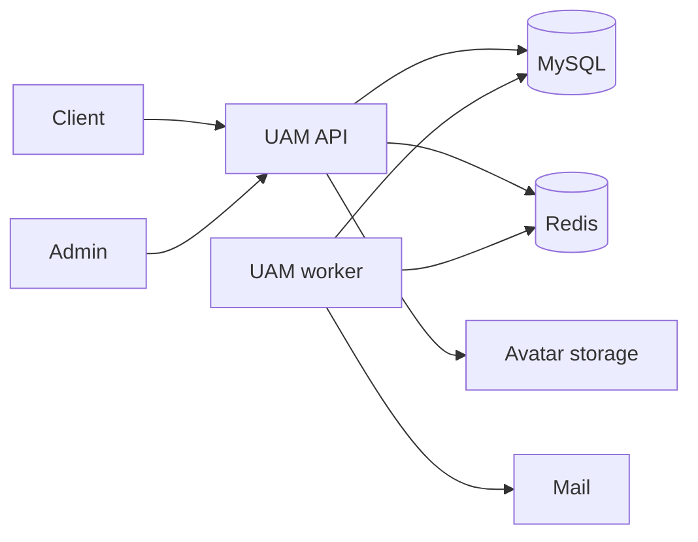

# System Context

UAM là một Go HTTP application quản lý danh tính, xác thực, phiên và RBAC. Public
contract có 41 operations dưới `/api/v1`, cộng liveness và readiness. Operation mới
phải có semantic owner, contract test và generated OpenAPI trong cùng thay đổi.

## External systems

| System | Production responsibility |
| --- | --- |
| MySQL | Durable account, profile, session, RBAC, security workflows, audit and outbox |
| Redis | TTL-only rate, ban, JTI, refresh-reuse, MFA challenge and worker lease state |
| Mail | `cmd/worker` delivers encrypted durable outbox events with bounded concurrency |
| Avatar storage | Shared S3-compatible object storage; local adapter is development-only |
| Migration | `cmd/migrate` runs as an explicit deployment job; API never migrates |

## Compatibility boundary

- Preserve method/path, request/response envelope and production data for all 41 operations.
- New operations need one semantic owner and cannot deform an existing route.
- Internal packages and schema may change through reviewed forward migrations.
- Keep the modular monolith; do not add a second production implementation for one use case.
